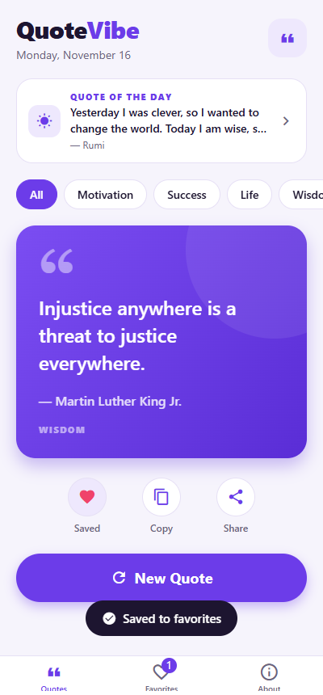
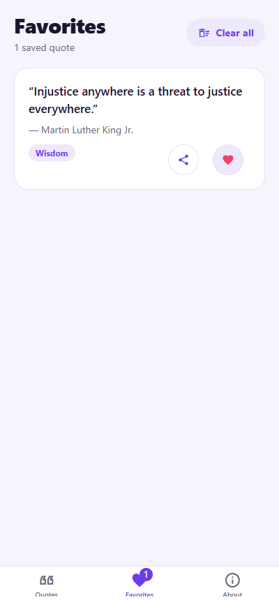
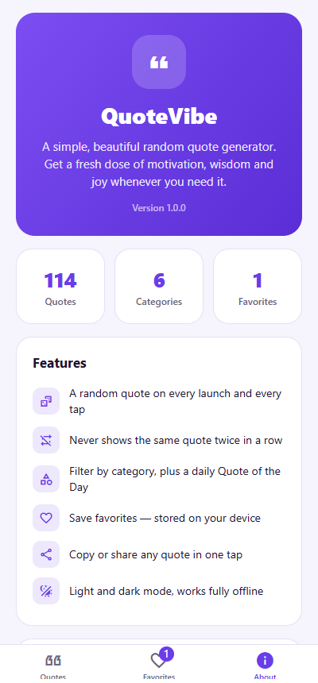
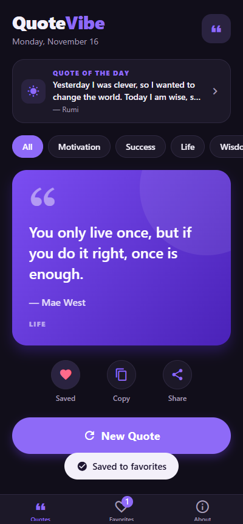
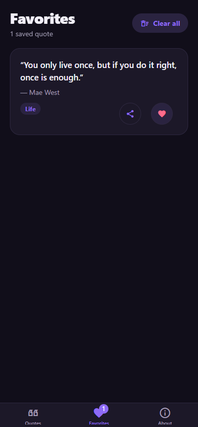
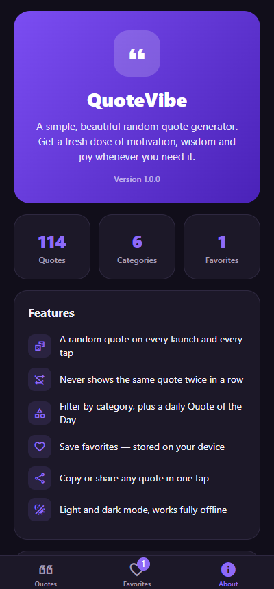

# QuoteVibe — Random Quote Generator

A clean, minimal mobile app that shows a random inspirational quote every time you open it or tap a button. Built with **React Native + Expo** for the **CodeAlpha App Development Internship — Task 2**.

Frontend only: no backend, no login, works fully offline.

## CodeAlpha requirements

| # | Requirement | How QuoteVibe meets it |
|---|-------------|------------------------|
| 1 | Show a random quote every time the user opens the app or taps a button | A random quote is picked when the app starts (`useState(() => pickRandom(QUOTES))`), and again on every **New Quote** tap or category change |
| 2 | A "New Quote" button that shows a different quote each tap | `pickRandom(list, excludeId)` in [`src/utils/random.js`](src/utils/random.js) leaves out the current quote, so the same quote never shows twice in a row |
| 3 | Each quote shows the text and the author clearly | Large white quote text (24px, 1.4 line height) on a gradient card, with "— Author" underneath |
| 4 | Clean, minimal UI | A purple theme, rounded cards, pill buttons, plenty of spacing, and automatic light/dark mode |

## Features

- 🎲 **Random quotes:** 114 quotes in 6 categories (Motivation, Success, Life, Wisdom, Happiness, Love)
- 🔁 **No repeats in a row:** each **New Quote** tap is guaranteed to show a different quote
- ☀️ **Quote of the Day:** the same quote all day, chosen from the date. Tap it to show it in the main card
- 🏷️ **Category filter:** chips limit the random pick to one category
- ❤️ **Favorites:** saved on the device with AsyncStorage; every screen updates at once through React context
- 📋 **Copy:** copies `"quote" — Author` to the clipboard and shows a "Copied!" toast
- 📤 **Share:** opens the native share sheet (on web it uses the Web Share API, or copies the quote if that isn't available)
- ✨ **Animation:** each new quote fades and slides in (React Native Animated API)
- 🌗 **Dark mode:** follows the phone's setting
- 📱 **Responsive:** mobile-first, with a 640px max content width on tablets and desktop
- ♿ **Accessible:** every button has an accessibility label

## Screenshots

| Quotes | Favorites | About |
|:-----:|:---------:|:-----:|
|  |  |  |
|  |  |  |

## Tech stack

- [React Native](https://reactnative.dev/) + [Expo](https://expo.dev/) (SDK 58), JavaScript
- [Expo Router](https://docs.expo.dev/router/introduction/): file-based routing with bottom tabs
- `@react-native-async-storage/async-storage`: stores favorites
- `expo-clipboard`: Copy
- React Native `Share` API: Share
- `expo-linear-gradient`: gradient quote card
- `@expo/vector-icons` (MaterialCommunityIcons): icons
- React Native `Animated` API: quote transitions
- No UI kit libraries; every component is hand-built

## Project structure

```
src/
├── app/                      # Expo Router routes
│   ├── _layout.js            # Root: theme + QuoteProvider + Stack
│   └── (tabs)/
│       ├── _layout.js        # Bottom tabs (Quotes, Favorites, About)
│       ├── index.js          # Quotes (home) screen
│       ├── favorites.js      # Saved quotes
│       └── about.js          # App info
├── components/
│   ├── QuoteCard.js          # Animated gradient quote card
│   └── ui.js                 # Screen, Button, Chip, IconButton, Toast, EmptyState, confirm(), notify()
├── context/
│   └── QuoteContext.js       # Favorites state shared by all screens
├── data/
│   └── quotes.js             # 114 quotes: { id, text, author, category }
├── db/
│   └── storage.js            # AsyncStorage: getFavorites, toggleFavorite, clearFavorites
├── utils/
│   ├── random.js             # pickRandom (no repeats), getQuoteOfTheDay
│   └── quoteActions.js       # formatQuote, copyQuote, shareQuote
└── theme.js                  # Light + dark palettes, useAppTheme()
```

## How to run

**Prerequisites:** [Node.js](https://nodejs.org/) (LTS) and the **Expo Go** app on your phone ([Android](https://play.google.com/store/apps/details?id=host.exp.exponent) / [iOS](https://apps.apple.com/app/expo-go/id982107779)).

```bash
# 1. Clone the repository
git clone https://github.com/amiirofahad4-ai/CodeAlpha_RandomQuoteGenerator-.git
cd CodeAlpha_RandomQuoteGenerator-

# 2. Install dependencies
npm install

# 3. Start the development server
npx expo start
```

Then:

- **Phone:** scan the QR code with Expo Go (Android) or the Camera app (iOS)
- **Android emulator:** press `a`
- **iOS simulator (macOS):** press `i`
- **Web browser:** press `w`

### Quality checks

```bash
npm run lint        # ESLint (eslint-config-expo)
npx expo-doctor     # Expo project health checks
```

## Author

Built by **&lt;Your Name&gt;** for the CodeAlpha App Development Internship.

## License

[MIT](LICENSE)
